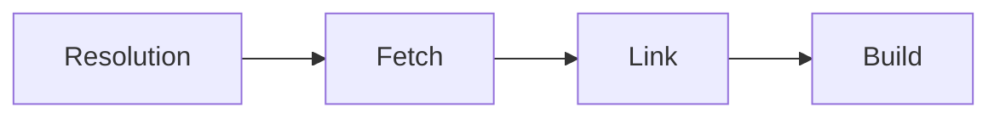

# yarn install

Installe les dépendances du projet.

Source : aide `yarn install --help` (Yarn 4.18.1), https://yarnpkg.com/cli/install

## Usage

```
yarn install
```

## Options

| Option | Description |
| --- | --- |
| `--json` | Sortie au format flux NDJSON |
| `--immutable` | Quitte en erreur si le lockfile devait être modifié |
| `--immutable-cache` | Quitte en erreur si le dossier de cache devait être modifié |
| `--refresh-lockfile` | Rafraîchit les métadonnées de paquets stockées dans le lockfile |
| `--check-cache` | Retélécharge toujours les paquets et vérifie la cohérence de leurs checksums |
| `--check-resolutions` | Vérifie que les résolutions de paquets sont cohérentes |
| `--inline-builds` | Affiche en direct la sortie des étapes de build des dépendances |
| `--mode <mode>` | Change les artefacts générés par l'installation |

## Détails

La commande prépare le projet si nécessaire. L'installation se découpe en quatre étapes :



- **Resolution :** le gestionnaire de paquets résout les dépendances. La façon dont une version est privilégiée par rapport à une autre n'est pas standardisée au-delà des garanties semver. Si un paquet ne se résout pas comme prévu, vérifier que toutes les dépendances sont correctement déclarées.
- **Fetch :** téléchargement des dépendances si besoin et stockage dans le cache (la valeur de `cacheFolder` dans `yarn config` indique où sont les fichiers de cache).
- **Link :** envoi de l'information de l'arbre de dépendances à des plugins internes chargés de l'écrire sur disque (par exemple en générant le fichier `.pnp.cjs`).
- **Build :** une fois l'arbre écrit sur disque, exécution des scripts de build des paquets qui en ont besoin, dans un ordre topologique compatible avec leurs dépendances mutuelles. Détails : https://yarnpkg.com/advanced/lifecycle-scripts

Lancer cette commande ne fait pas partie du workflow recommandé. Yarn supporte les zero-installs : tant que le cache et le fichier `.pnp.cjs` sont stockés dans le dépôt, tout fonctionne sans install après un clone ou un changement de branche.

`--immutable` (activé par défaut en CI) : Yarn quitte en erreur si le lockfile devait être modifié (d'autres chemins peuvent être ajoutés via `immutablePatterns`). Un alias `--frozen-lockfile` existe par compatibilité et sera retiré dans une release future.

`--immutable-cache` : Yarn quitte en erreur si le dossier de cache devait être modifié (fichiers ajoutés ou supprimés).

`--refresh-lockfile` : Yarn garde la même résolution pour les paquets du lockfile mais rafraîchit leurs métadonnées. Avec `--immutable`, il peut valider la cohérence des informations du lockfile. Ce flag est activé par défaut quand Yarn détecte un contexte de pull request.

`--check-cache` : Yarn retélécharge toujours les paquets et vérifie que leur checksum correspond 1/ à celui du lockfile 2/ à celui des fichiers de cache existants (s'ils sont présents). Recommandé en CI si le modèle Zero-Installs est utilisé et que des PR de tiers sont acceptées : sans cela, ces PR pourraient altérer les paquets versionnés avant soumission.

`--inline-builds` : Yarn affiche en direct la sortie des étapes de build des dépendances (au lieu de l'écrire dans des fichiers individuels). Utile surtout pour le debug dans des environnements de type Docker.

Avec `--mode=<mode>`, Yarn change les artefacts générés. Modes supportés :

- `skip-build` : n'exécute aucun script de build. Différent de `enableScripts: false`, qui désactive les scripts et modifie donc le contenu des artefacts sur disque.
- `update-lockfile` : saute l'étape de link et ne récupère que les paquets absents du lockfile (ou sans checksum). Typiquement utilisé par Renovate ou Dependabot.

## Exemples

Installer le projet :

```
yarn install
```

Valider un projet en Zero-Installs :

```
yarn install --immutable --immutable-cache
```

Valider un projet en Zero-Installs (un peu plus sûr si des PR externes sont acceptées) :

```
yarn install --immutable --immutable-cache --check-cache
```
